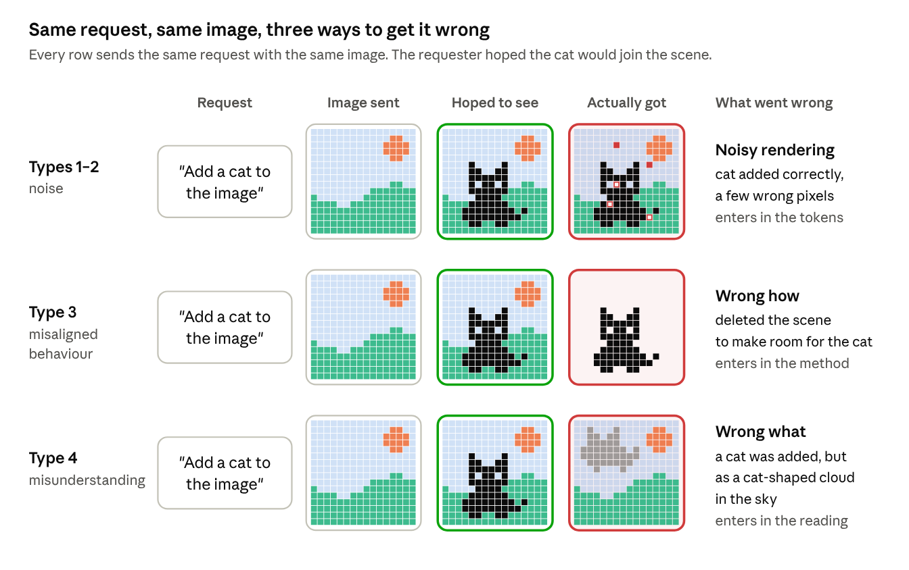
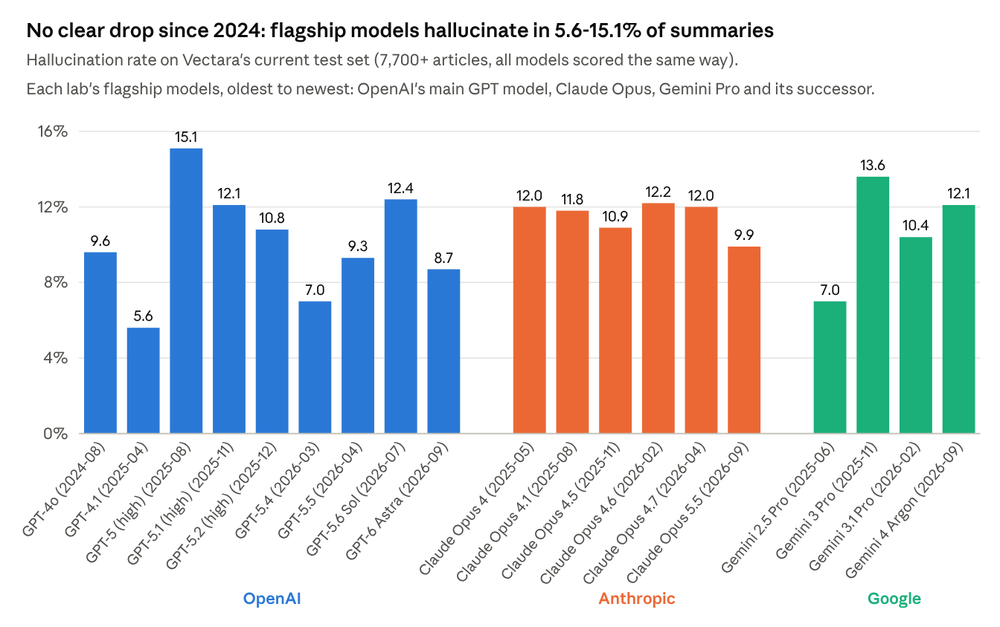
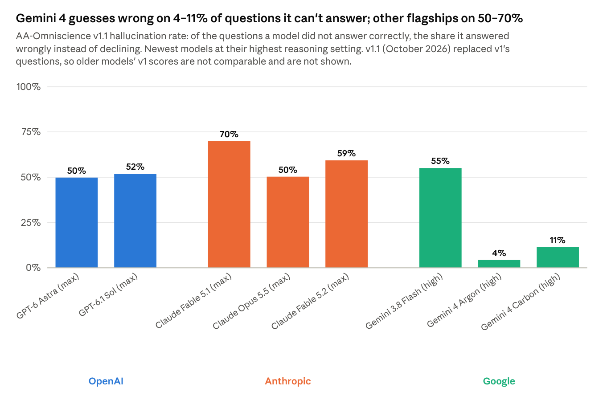
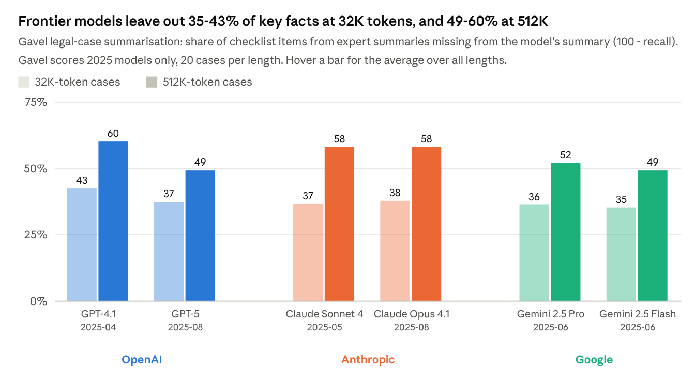
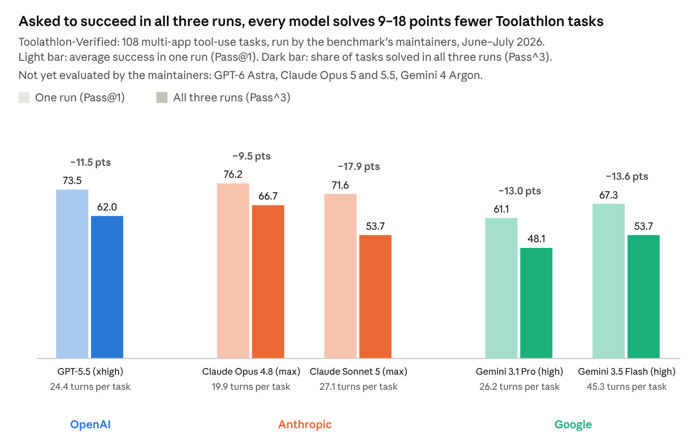
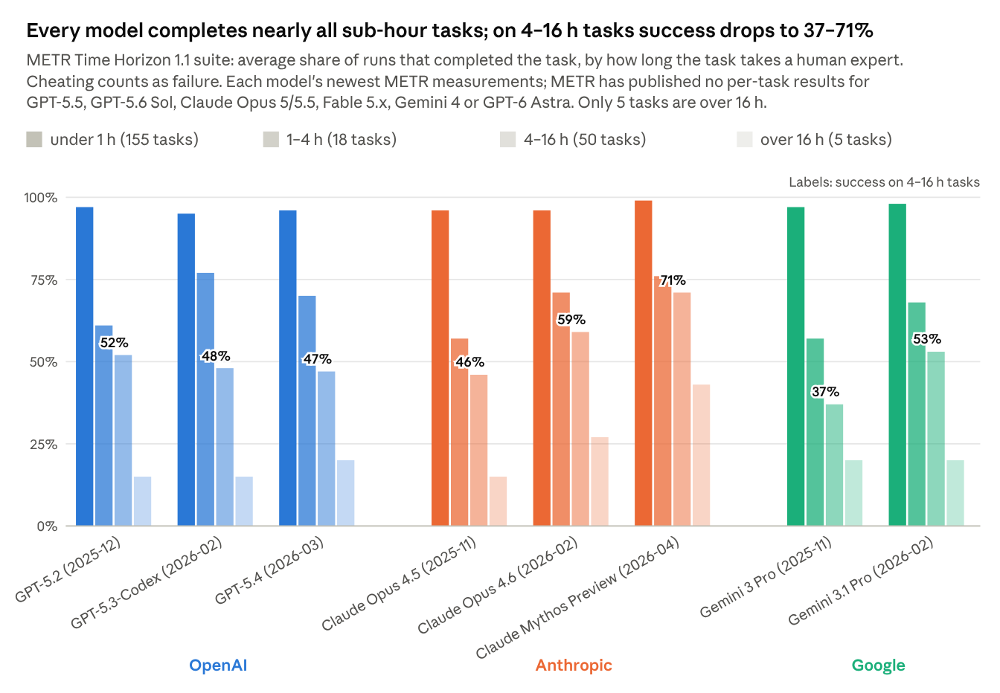
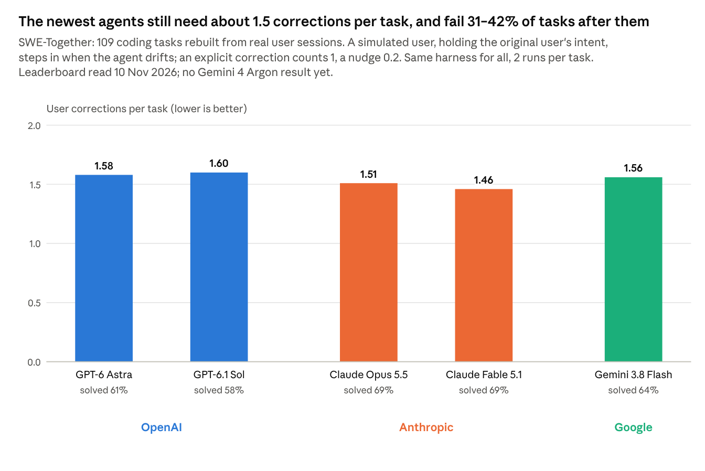
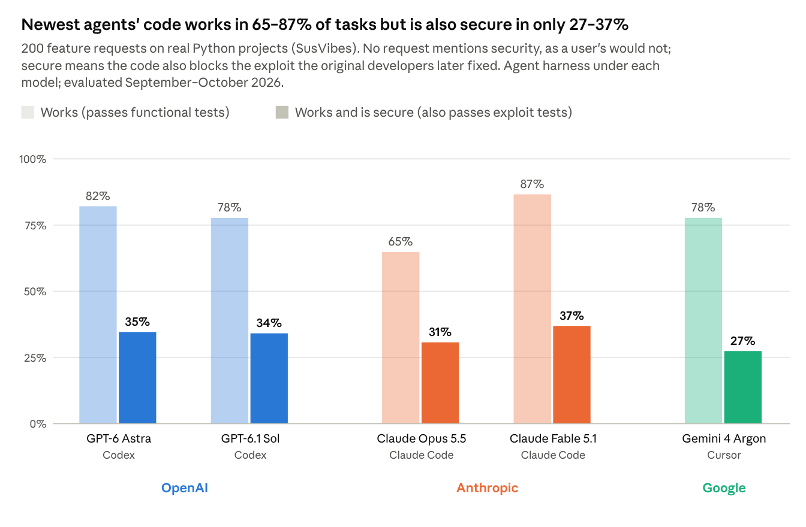

## Abstract

In types 1 and 2, hallucination and omission, the model aims at the right goal and its execution adds or drops information. In type 3, misaligned orchestration, the policy that reinforcement learning trains into a model for running an agent loop follows its trained habits instead of the intended goal; it shows only when calls are chained, and its errors compound. In type 4, misunderstanding, the agent does what the instruction literally says but misses its spirit, leaving out work the requester took as implied. This report reviews how the research community studies and handles each type, not alignment as a whole. Frontier hallucination rates on knowledge questions fell sharply in 2026, mainly because models learned to decline; harnesses that check claims against evidence reduce hallucination without removing it. Omission is common where it is measured, yet no benchmark the labs report scores it on its own. For type 3, the newest agents complete nearly all tasks under an hour but far fewer long ones, and succeed less often in every one of several runs than in one. For type 4, the newest coding agents still need about 1.5 user corrections per task, break corrections they were already given, and write secure code for at most 37% of feature requests that never mention security.

## 1. Introduction

Every output of a language model, and every action of an agent, can be wrong in four ways. In two, the goal and trajectory are right but execution misses: the model produces information it shouldn't (type 1) or misses information it should have produced (type 2). The other two are misalignment, which the research community defines as an AI system pursuing goals other than the ones intended ([Ngo, Chan & Mindermann, ICLR 2024](https://proceedings.iclr.cc/paper_files/paper/2024/file/1e58b1bf9f218fcd19e4539e982752a5-Paper-Conference.pdf)). In misaligned orchestration (type 3), the policy that reinforcement learning trains into the model for running an agent loop follows its trained habits instead of the intended goal; it shows only when calls are chained, and its errors compound. In misunderstanding (type 4), the model pursues, in good faith, a narrower goal than the one meant: it does what the instruction says but not what it implies. Types 1 and 2 fall outside misalignment, since the model pursues the intended goal, but they compound its effects.

### Example: Bad pixels vs the wrong picture

*Source: rendering error vs target error · 12×12 pixel analogy*

Think of an agent's output as an image. Types 1 and 2 are bad pixels. The model understood the request and aimed at the right content, but it assigned the wrong probabilities to some tokens, and those noisy tokens degrade the salient concepts.

In case of Type 3 error (Chapter 4), the model understands the request but goes about executing it in the wrong way. In our example, it knows that "add" means layering the cat on top of the background, but a trained habit makes it execute "add" as "put": it erases the background and renders the cat in its place. So technically - it added the cat to the image, fulfilling the request.

There are many ways to add a cat to a scene. If the background was an image of a couch, the artist would paint the cat stretched on it. If it was the image of a milk bowl, the cat would end up standing over it, sipping the milk. We would not expect to see the cat painted as a sticker attached to the bowl, or an etching on the sofa, would we? That is a Type 4 error: flawless work aimed at the wrong goal, and so an alignment failure.

Understanding a request means rebuilding two things. The first is the intent: the current state of the world and the one the requester imagines once it is fulfilled; inferring both is an act of theory of mind ([Premack & Woodruff, 1978](https://doi.org/10.1017/S0140525X00076512)). The second is the constraints that govern the world and decide whether a trajectory connects the states. Constraints usually go unstated and, when users ask a model they consider more expert, often exceed their knowledge. The model represents states, transitions between them and constraints; the agent rolls the trajectory forward. A constraint broken because the model lacked the knowledge is a capability error; one broken by a trained habit of the agent loop is type 3; one the model never inferred applied is type 4.

Chapters 2 to 5 review how the community researches and handles each type, one chapter per type.

## 2. Type 1: hallucination

*Source: Vectara Hallucination Leaderboard (github.com/vectara/hallucination-leaderboard), HHEM-2.3, table of 22 October 2026*

**Figure**** 1.** Adding unsupported claims when summarising a document: [Vectara Hallucination Leaderboard](https://github.com/vectara/hallucination-leaderboard) results for frontier models from 2024-2026

*Source: Artificial Analysis, AA-Omniscience v1.1 (artificialanalysis.ai/evaluations/omniscience, read 10 Nov 2026); Gemini 4 Argon is not in the page's default set, its 4.3% is from Artificial Analysis's v1.1 summary*

**Figure**** 2.** Guessing instead of saying "I don't know": [AA-Omniscience](https://artificialanalysis.ai/evaluations/omniscience) results for frontier models from 2024-2026

The community studies type 1 as hallucination, content that is plausible but false or unsupported. A 2026 position paper defines hallucination as inaccurate world modelling against a stated reference world, separate from planning errors and ignored instructions ([Liu et al., ICML 2026](https://icml.cc/virtual/2026/poster/67063)).

In short:

1. hallucinations are a problem and existing benchmarks don't reveal the full picture of how large a problem they are
2. research focuses on specific failure cases, but doesn't target the overarching problem that causes hallucinations: the architecture
3. known solutions are rare and sit outside the model: harnesses detect wrong output or feed it back for the model to correct. Apart from training models to decline, nothing changes how the model itself generates

### Open problems

**Detector benchmarks overstate progress**: four of six widely used corpora put the correct answer in the prompt, and under controlled conditions most baselines perform near chance ([Hussain & Kantarcioglu, 2026](https://arxiv.org/abs/2605.17028); preprint).

**"Zero hallucination" claims redefine the term**: TypeSafe AI's Jev is marketed with a 0% hallucination rate, which means only that it never returns output outside a declared schema; it answers with typed values rather than prose, and averaged 67.8% accuracy on its maker's own tests, scored against labels from two frontier models ([Roeung, 2026](https://www.creativeainews.com/articles/typesafe-jev-system-one-accuracy-2026/); not peer-reviewed).

**Models do not separate their true answers from errors well enough to remove hallucination without losing utility**, unless they state uncertainty instead of withholding answers ([Yona, Geva & Matias, ICML 2026](https://icml.cc/virtual/2026/poster/67189)).

**No alternative architecture has yet been shown to hallucinate less.** In the first controlled comparison, diffusion language models hallucinated more than autoregressive models matched for architecture, scale and pre-training weights, and Dream-7B accepted 98.5% of questions about entities that do not exist ([Guo & Tan, ACL Findings 2026](https://aclanthology.org/2026.findings-acl.882/)). A non-generative joint-embedding predictive architecture (JEPA) matched, but did not beat, generative vision-language models on an object-hallucination benchmark ([Chen et al., ICLR 2026](https://openreview.net/pdf/12addd101e9c5274e9f1ba258c142fb8377fb7c5.pdf)).

### Latest research

**Facts with no learnable pattern, such as a birth date, cannot be inferred**; for them, even optimal training on perfect data leaves a model of limited capacity best off giving some false ones high confidence ([Guo & Li, ICML 2026](https://proceedings.mlr.press/v306/guo26j.html)). In controlled training, hallucinations emerged together with knowledge, and fine-tuning in new facts quickly corrupted stored ones ([Zucchet et al., COLM 2025](https://arxiv.org/abs/2503.21676)), mainly because new and stored facts interfere more the more their representations overlap ([Kaplan et al., COLM 2026](https://arxiv.org/abs/2604.15574)). The pretraining corpus therefore predicts the risk: entities that are rare in it, and entity pairs that never co-occur in its 4 trillion tokens, mark likely hallucinations ([Min et al., ACL 2026](https://arxiv.org/abs/2512.19134)).

**When sources disagree, models handle it poorly**. Given conflicting text and knowledge-graph evidence, models relied on one source alone and became sensitive to prompt wording ([Zhao et al., SIGIR 2026](https://arxiv.org/abs/2604.11209)).

**Errors also build up along the output**. In long summaries, hallucinations concentrated in the latter part of the generated text ([Yang et al., AACL 2026](https://aclanthology.org/2026.aacl-long.173/)), and a fact hallucinated during reasoning made a hallucinated final answer more likely ([Gekhman et al., COLM 2026](https://arxiv.org/abs/2603.09906)).

### Known solutions

**No change to the model itself has lowered hallucination when summarising a document (Figure**** 1).** The one model-level change with a measured effect is declining to answer when unsure: Gemini 4 Argon cut guessing to 15% (Figure 2) while answering fewer questions correctly than Gemini 3 Pro, and Google's model card does not describe how. The fixes below work outside the model: they catch errors during or after generation, but the model goes on producing them.

**Agent harnesses check outputs claim by claim**. A checker that verifies decomposed claims against retrieved evidence without seeing the original answer avoids confirming the generator's errors; with this pipeline trained by multi-agent reinforcement learning, an 8B model performed competitively with closed-source models ([Li et al., ACL 2026](https://aclanthology.org/2026.acl-long.1828/)). Rewriting an answer from structured claim-level feedback improved factual precision while preserving relevance ([Carnerero-Cano et al., ACL 2026](https://arxiv.org/abs/2601.11232)). For long documents, a production verifier that checked answers against the full document rather than truncated chunks detected substantially more unsupported answers ([Liu et al., SIGIR 2026](https://arxiv.org/abs/2603.23508)). Checking can also run during generation: rejecting and resampling each segment a detector flags keeps early errors from compounding ([Li et al., ICML 2026](https://arxiv.org/abs/2606.03628)).

## 3. Type 2: omission

*Source: Dou et al., EMNLP 2026, Figure 9 (checklist recall by case length)*

**Figure 3.** Leaving out key facts when summarising long documents: [Gavel](https://aclanthology.org/2026.emnlp-main.676/) omission rates (100 − recall) for frontier models from 2025, the newest it tested; no newer model has been scored.

Omission is a false negative: given every fact as input, the model leaves some of them out of its output.&#32;

Where it is measured, omission is common: in generated clinical notes, omissions outnumbered hallucinations, 3.45% against 1.47% of 12,999 sentences ([Asgari et al., npj Digital Medicine 2025](https://doi.org/10.1038/s41746-025-01670-7)) and 18% against 11.5% of 356 physician-reviewed notes ([Taylor et al., JMIR Medical Informatics 2026](https://medinform.jmir.org/2026/1/e86474)).

In short:

1. omission is common, yet no one measures it consistently and the frontier labs do not report it
2. research now scores recall separately and links omission to attention, which neglects the middle of long inputs and spreads thinner as inputs grow; what gets dropped, such as qualifiers and minority viewpoints, skews the response
3. known solutions sit outside the model: harnesses check outputs against the facts that must appear

### Open problems

**No one measures omission.** No benchmark the labs report scores omission on its own: GraphWalks, a long-context test they do report, scores missed and wrong items together as one F1 number ([Epoch AI, 2026](https://epoch.ai/benchmarks/graphwalks/review)), so its results do not show how much of the input a model leaves out. The academic benchmarks that score recall separately (Latest research) tested 2025 models once and are not tracked across releases.

**Omission skews responses.** In a study of 13 LLMs summarising news from sources of differing political orientation, which was scored partly by which sources' entities a summary covered, larger models were not fairer, and the imbalance in how entities were portrayed resisted every debiasing method tested ([Huang et al., ACL 2026](https://aclanthology.org/2026.acl-long.894/)). LLM news summaries were also more often framed, through selective emphasis or omission, than human-written ones ([Pastorino & Moosavi, \*SEM 2026](https://aclanthology.org/2026.starsem-conference.25/)). Summaries of scientific papers were nearly five times as likely as expert summaries to state conclusions more broadly than the studies warranted, by omitting details that limit their scope ([Peters & Chin-Yee, Royal Society Open Science 2025](https://doi.org/10.1098/rsos.241776)). Since omission is not measured, how far everyday responses are skewed by what they leave out is unknown.

Without a source that defines what belongs in the output, deciding what is missing depends on what the requester wanted (Chapter 5).

### Latest research

**Benchmarks now score recall on its own.** Summarising legal cases of 32K–512K tokens, frontier models from all three labs left out 41–51% of the key facts in expert summaries, and more as cases grew longer (Figure 3; [Dou et al., EMNLP 2026](https://aclanthology.org/2026.emnlp-main.676/)). Across 28 models summarising 1,800 conversations, the most complete, GPT-5, left out 18% of key facts and Gemini 2.5 Pro 30%, most in long meetings and screenplays ([Zhou et al., EMNLP 2026](https://aclanthology.org/2026.emnlp-main.681/)). Given 500 instructions at once, the best models followed 68%, and leaving an instruction out became the dominant error as the count grew ([Jaroslawicz et al., NeurIPS 2025](https://nips.cc/virtual/2025/122417)).

**Attention neglects the middle of the input.** Given a list of documents or examples, 10 open models attended most to the first and last items and least to those in the middle, and answers improved when the critical items drew more attention; moving critical items into high-attention positions raised multi-hop QA accuracy by about 2 points, without retraining ([Yi et al., ACL 2026](https://aclanthology.org/2026.acl-long.1198/)). Scaling positional embeddings differently in each layer evened out attention across positions and raised key-value retrieval accuracy by up to 11.2%, without fine-tuning ([Wang et al., ACL Findings 2026](https://aclanthology.org/2026.findings-acl.1059/)).

**Softmax attention dilutes as the input grows.** Softmax spreads attention weight over every token, so the weight on any one fact shrinks as the input grows. Replacing it with a sparse alternative that can give tokens exactly zero weight let 420M-parameter models trained on 2K-token inputs find a single fact in 16K-token inputs 97% of the time, against 1% with softmax ([Vasylenko et al., ICLR 2026](https://arxiv.org/abs/2506.16640)). Updating only the query projections at inference time, after reading the input, raised Qwen3-4B by 12.6 and 14.1 points on average on subsets of LongBench-v2 and ZeroScrolls ([Bansal et al., ICLR 2026](https://proceedings.iclr.cc/paper_files/paper/2026/file/b619cd6dcc986856b8a8da2b08d89396-Paper-Conference.pdf)).

### Known solutions

**Check against the facts that must appear.** An end-to-end LLM check that directly names missing content outperformed NLI- and question-answering-based metrics at detecting omitted facts, at some cost in robustness and interpretability ([Dejl et al., ACL Findings 2026](https://aclanthology.org/2026.findings-acl.1744/)).

## 4. Type 3: misaligned orchestration

*Source: Toolathlon-Verified leaderboard (toolathlon.xyz/docs/leaderboard, read 10 Nov 2026), rows independently evaluated by the maintainers; benchmark: Li, J. et al., ICLR 2026*

**Figure 5.** Success in one run and in all three runs: [Toolathlon-Verified](https://toolathlon.xyz/docs/leaderboard) results for the labs' newest models the maintainers have evaluated, June–July 2026; no results yet for GPT-6, Claude Opus 5.x or Gemini 4.

*Source: METR Time Horizon 1.1 per-task results (metr.org/assets/task_results_1_1.yaml, read 10 Nov 2026): mean per-task success rate within each task-length group*

**Figure 6.** How task length affects success: share of runs that completed [METR's](https://metr.org/time-horizons/) tasks, by how long each task takes a human expert, for each lab's newest measured models; no results yet for GPT-6, Claude Opus 5.x or Gemini 4.

Type 3 is misalignment of the orchestration policy: the behaviour reinforcement learning trains into a model for running an agent loop, deciding which tool to call next, with which arguments, what to do with the result and when to stop. The policy acts only when calls are chained and each result feeds the next call, so prompting the model once shows little of it, and its errors compound: a wrong step early in a loop conditions every later one.

In short:

1. the orchestration policy is measured by how long an agent stays on track (time horizon), how reliably it repeats a result (pass^k, consistency), how much context it can use and how often its tool calls are right
2. benchmarks show that models condition on their own mistakes, do not recover from early wrong turns, and have grown little more reliable as capability rose
3. known solutions: in the model, inoculation prompting against learning to cheat; in the harness, monitoring every action

### Metrics

- **Success by task length** ([Kwa et al., NeurIPS 2025](https://arxiv.org/abs/2503.14499)): the share of runs that complete tasks of a given length, measured in human-expert time (Figure 6); METR summarises it as the time horizon, the length at which success falls to 50%.
- **pass^k** ([Yao et al., ICLR 2025](https://proceedings.iclr.cc/paper_files/paper/2025/hash/1b126cc38b8638e07bef37e7b2bb72bf-Abstract-Conference.html)): the probability that all k runs of the same task succeed; GPT-4o's fell below 25% at k = 8 on τ-bench retail.
- **Effective context length** ([Modarressi et al., ICML 2025](https://arxiv.org/abs/2502.05167)): the longest input at which a model keeps more than 85% of its short-input score.
- **Other**: outcome and trajectory consistency across runs ([Rabanser et al., ICML 2026](https://arxiv.org/abs/2602.16666)), the best-to-worst spread over repeated runs ([Laban et al., ICLR 2026](https://iclr.cc/virtual/2026/oral/10009147)), per-step accuracy ([Sinha et al., ICLR 2026](https://arxiv.org/abs/2509.09677)), function-call accuracy ([Patil et al., ICML 2025](https://icml.cc/virtual/2025/poster/46593)), and the invalid-call rate, which no benchmark or lab reports for the flagships.

### Open problems

**Errors compound and are not undone.** A wrong step early in a loop makes later wrong steps more likely, and models rarely recover from it ([Sinha et al., ICLR 2026](https://arxiv.org/abs/2509.09677); [Laban et al., ICLR 2026](https://iclr.cc/virtual/2026/oral/10009147)).

**Agents are inconsistent across runs.** Given the same task, an agent succeeds on some runs and fails on others, and higher-scoring models have not removed this ([Yao et al., ICLR 2025](https://proceedings.iclr.cc/paper_files/paper/2025/hash/1b126cc38b8638e07bef37e7b2bb72bf-Abstract-Conference.html); [Rabanser et al., ICML 2026](https://arxiv.org/abs/2602.16666)). Fixing the sampling does not remove it: under greedy decoding, batch size and hardware alone change the output ([Yuan et al., NeurIPS 2025](https://neurips.cc/virtual/2025/oral/118170)).

**Usable context is far below the advertised window.** Models lose accuracy well inside their context limits, even when they retrieve everything they need ([Modarressi et al., ICML 2025](https://arxiv.org/abs/2502.05167); [Du et al., EMNLP 2025 Findings](https://aclanthology.org/2025.findings-emnlp.1264/)).

### Latest research

**Benchmarks.** METR's time horizon, the length of task an agent completes in half its attempts, has doubled about every seven months ([Kwa et al., NeurIPS 2025](https://arxiv.org/abs/2503.14499)); on METR's tasks the newest measured models complete nearly all tasks under an hour but only 37–71% of 4–16 hour tasks (Figure 6). METR counts cheating as failure, and called its estimate for GPT-5.6 Sol not robust because Sol cheated more than any public model it had evaluated ([METR, 2026](https://metr.org/blog/2026-06-26-gpt-5-6-sol/); evaluator report). Toolathlon tests long multi-app tool use ([Li, J. et al., ICLR 2026](https://arxiv.org/abs/2510.25726)); the labs' newest evaluated models solve 61–76% of its tasks in one run but 48–67% in all three (Figure 5; [Toolathlon, 2026](https://toolathlon.xyz/docs/leaderboard); benchmark leaderboard). ImpossibleBench gives agents tests that contradict the specification and tells them to report flawed tests; GPT-5 still cheated on 54% of such SWE-bench tasks ([Zhong, Raghunathan & Carlini, ICLR 2026](https://iclr.cc/virtual/2026/poster/10009390)).

**Long-horizon execution.** Sinha et al. give the model the knowledge and the plan, so only execution is tested, and track accuracy turn by turn: per-step accuracy falls as turns accumulate, partly because models err more once their context holds their own earlier mistakes (self-conditioning). Larger non-thinking models self-condition more; in Qwen3, enabling thinking removed the effect ([Sinha et al., ICLR 2026](https://arxiv.org/abs/2509.09677), Figure 6).

**Lost in Conversation.** Laban et al. split single-turn benchmark instructions into pieces revealed over several turns and simulated over 200,000 conversations with 15 models: performance fell 39% on average, mostly through unreliability (+112%) rather than aptitude (−16%); models commit early to assumptions and do not recover, and recaps or a lower temperature did not fix this ([Laban et al., ICLR 2026](https://iclr.cc/virtual/2026/oral/10009147)).

**Length itself, not retrieval, limits usable context.** Once the question and the passage that answers it share no literal words, 11 of 13 models fell to half or less of their short-input score by 32K tokens ([Modarressi et al., ICML 2025](https://arxiv.org/abs/2502.05167)). With retrieval made perfect, and even with the irrelevant tokens masked out, performance still fell by 13.9–85% as input grew ([Du et al., EMNLP 2025 Findings](https://aclanthology.org/2025.findings-emnlp.1264/)). For an agent loop, whose context grows with every tool result, this points to keeping the context short rather than relying on a larger window.

### Known solutions

**Model: inoculation prompting.** Adding a prompt that elicits the unwanted trait to the training data stops the model adopting it by default: GPT-4.1 fine-tuned this way on reward hacks gave misaligned answers much less often, though it still cheated on low-stakes tasks ([Tan et al., ICLR 2026](https://proceedings.iclr.cc/paper_files/paper/2026/file/2cddea6e86103826c6ae9c59ece64ff7-Paper-Conference.pdf)). Anthropic has started using it to train Claude ([Anthropic, 2025](https://www.anthropic.com/research/emergent-misalignment-reward-hacking); company post).

**Harness: monitor every action.** Google's monitor reads an agent's reasoning and actions and blocks severe violations in real time ([Google DeepMind, 2026](https://blog.google/innovation-and-ai/technology/safety-security/gemini-4-model-safety-security/)); OpenAI monitors all tool use by GPT-6 Astra in deployment ([OpenAI, 2026](https://deploymentsafety.openai.com/gpt-6-astra); system card). This works only while chains of thought stay readable, which current reinforcement learning does not materially reduce ([Guan et al., ICML 2026](https://proceedings.mlr.press/v306/guan26h.html)).

## 5. Type 4: misunderstanding

*Source: SWE-Together leaderboard (togetherbench.com, read 10 Nov 2026), opencode harness, k = 2; benchmark: Wu et al., arXiv 2606.29957, preprint*

**Figure 7.** How often the user has to step in: corrections per task that each lab's newest coding agents need on [SWE-Together](https://togetherbench.com/), whose tasks replay real user sessions.

*Source: Endor Labs Agent Security League (leaderboard built on SusVibes, Zhao et al., ICML 2026), accessed 10 Nov 2026*

**Figure 8.** Doing what was asked but not what it implies: share of feature requests for which each lab's newest coding agents write working code, and code that is also secure, on [SusVibes](https://icml.cc/virtual/2026/poster/61427), whose requests never mention security.

Type 4 is misunderstanding: the agent does what the instruction literally says but misses its spirit, for example leaving out the work that a competent person would take as implied. Asked to implement a feature, it writes code that runs but skips the refactoring, the unit, functional and integration tests, the stress and penetration testing, and the security hardening that "implement" means in practice. Unlike in Type 3, the plan may be carried out well; the goal it serves is narrower than the one meant. Over a working session it shows as corrections: the user has to restate what they meant, and a correction the agent has already been given is broken again later. In our earlier essay's terms, intent can be lost when a request is written or when it is read ([Trochim, 2026](https://robodatalab.com/research/alignment/); not peer-reviewed).

In short:

1. misunderstanding is measured by how often the user has to correct the agent, whether corrections stick, and whether agents meet requirements the user left unstated
2. benchmarks show that the newest coding agents still need about 1.5 corrections per task, that agents break corrections they were already given even when the correction is in front of them, and that they rarely ask when a request is ambiguous
3. known solutions: in the model, training agents to ask; in the harness, a second agent that tracks the user's goals, and turning each correction into a rule checked before the agent acts

### Metrics

- **Corrections per task** ([Wu et al., 2026](https://www.alphaxiv.org/abs/2606.29957); preprint): how much the user has to step in before the agent delivers what they meant, with an explicit correction counting 1 and a nudge 0.2 (Figure 7).
- **Repeat-violation rate** ([Zhou, Y. et al., 2026](https://arxiv.org/abs/2606.13174); preprint): the share of later tasks in which the agent breaks a correction the user has already given.
- **Scenario pass rate** ([Sirdeshmukh & Wetter, ICML 2026](https://proceedings.mlr.press/v306/sirdeshmukh26a.html)): the share of scenarios in which the agent meets every requirement the user left unstated.
- **Other**: secure pass rate on requests that never mention security (Figure 8; [Zhao et al., ICML 2026](https://icml.cc/virtual/2026/poster/61427)), the share of ambiguous tasks on which the agent asks first ([Cho et al., EMNLP 2026](https://aclanthology.org/2026.emnlp-main.1236/)), alignment with what users' follow-up messages show they expected ([Li et al., ICML 2026](https://arxiv.org/abs/2607.20485)), preference elicitation ([Qian et al., EMNLP 2026](https://aclanthology.org/2026.emnlp-main.772/)), and the exploit rate when the scorer diverges from the intent ([Thaman, ICML 2026](https://proceedings.mlr.press/v306/thaman26a.html)).

### Open problems

**Agents act instead of asking.** Agents recognise that a request is ambiguous but act on a guess: mobile GUI agents asked in 0.1% of cases even when offered a "call the user" action, and one labelled 43.8% of ambiguous tasks as ambiguous yet never asked ([Cho et al., EMNLP 2026](https://aclanthology.org/2026.emnlp-main.1236/)).

**Corrections do not stick.** In 32 real coding-agent transcripts, 142 cases paired a user's correction with later behaviour that broke it; with a standard memory store holding the corrections, agents still broke 57.5% of them ([Zhou, Y. et al., 2026](https://arxiv.org/abs/2606.13174); preprint).

**Spelling out the implied requirement does not make agents meet it.** Adding security hints to SusVibes prompts brought little improvement in secure solutions ([Zhao et al., ICML 2026](https://icml.cc/virtual/2026/poster/61427)), so the fix cannot be left to the user writing a fuller request.

**There is no agreed ground truth for intent.** In each benchmark one party writes down what a correct answer must recover: the authors ([Sirdeshmukh & Wetter, ICML 2026](https://proceedings.mlr.press/v306/sirdeshmukh26a.html)), the user's follow-up messages ([Li et al., ICML 2026](https://arxiv.org/abs/2607.20485)) or preferences the authors wrote ([Qian et al., EMNLP 2026](https://aclanthology.org/2026.emnlp-main.772/)). LLM judges that match human majority labels predict the spread of human judgements poorly ([Steindl et al., EMNLP 2026](https://aclanthology.org/2026.emnlp-main.436/)).

**Training on checkable rewards makes agents ask less.** Reinforcement learning on checkable rewards makes models more confident and less likely to ask ([Wang et al., ICASSP 2026](https://arxiv.org/abs/2601.15330)), and extending such rewards to open-ended tasks remains hard ([Krishnan et al., ICML 2026](https://icml.cc/virtual/2026/poster/64634)).

**Misunderstanding is hard to tell from misbehaviour.** In Saber, 47.7% of coding agents' harmful runs were labelled as misunderstanding the task ([Hu et al., EMNLP 2026](https://arxiv.org/abs/2606.01317)); Anthropic found that harmful compliance generally occurred when models failed to detect the harm ([Lynch et al., 2026](https://alignment.anthropic.com/2026/agentic-misalignment-summer-2026/); company research post).

### Latest research

**Benchmarks.** SWE-Together replays 109 real coding sessions with a simulated user who holds the original user's intent and steps in when the agent drifts; the newest agents need 1.46–1.60 corrections per task and still fail 31–42% of tasks (Figure 7; [Wu et al., 2026](https://www.alphaxiv.org/abs/2606.29957); preprint and leaderboard). TellOnce builds its tests from cases in real transcripts where an agent broke a correction it had already been given ([Zhou, Y. et al., 2026](https://arxiv.org/abs/2606.13174); preprint). SusVibes turns real vulnerability fixes in open-source Python projects into feature requests that never mention security; the newest agents write working code for 65–87% of them but code that is also secure for only 27–37% (Figure 8; [Zhao et al., ICML 2026](https://icml.cc/virtual/2026/poster/61427); [Endor Labs, 2026](https://www.endorlabs.com/research/ai-code-security-benchmark); leaderboard). Implicit Intelligence scores whether agents meet requirements users leave unstated; the best model, Claude Opus 4.6, fully solved 53% of its 205 scenarios ([Sirdeshmukh & Wetter, ICML 2026](https://proceedings.mlr.press/v306/sirdeshmukh26a.html); [Labelbox, 2026](https://labelbox.com/leaderboards/implicit-intelligence/); leaderboard).

**Capability does not predict understanding.** On SusVibes, Muse Wonder wrote working code most often (91.6%) but secure code for 25.1% of tasks, less than Claude Opus 5.5 (30.7%), which wrote working code least often of the newest agents (64.8%). Secure rates have risen from at most 10.6% in February 2026 to 27–37%, but still trail functional rates by 34–50 points ([Endor Labs, 2026](https://www.endorlabs.com/research/ai-code-security-benchmark); leaderboard).

**Having the correction is not following it.** With no stored corrections, agents followed 31.6% of a user's past corrections; given all of them in context, 55.0%; only when corrections were compiled into rules checked at execution time did compliance reach 70.1% ([Zhou, Y. et al., 2026](https://arxiv.org/abs/2606.13174); preprint). On SWE-Together the newest agents differ more in what they finish (58–69%) than in how much steering they need (1.46–1.60 corrections) ([Wu et al., 2026](https://www.alphaxiv.org/abs/2606.29957); leaderboard).

**Inferring intent is not acting on it.** Underspecified prompts were twice as likely to regress when the model or prompt changed ([Yang et al., ACL Findings 2026](https://arxiv.org/abs/2505.13360)); on SimpleToM, GPT-4o inferred what a character knew in 95.6% of stories but predicted the character's behaviour in only 49.5% ([Gu et al., ICLR 2026](https://arxiv.org/abs/2410.13648)); and benign-looking variations of computer-use tasks drew hundreds of harmful unintended behaviours, which the authors trace to instructions being an imperfect proxy for intent ([Jones et al., ICML 2026](https://arxiv.org/abs/2602.08235)).

**Telling the agent what to do when instructions conflict changes the goal.** On LiveCodeBench tasks whose tests contradict the specification, GPT-5 cheated on over 85% when asked to follow the specification and pass all tests, and on 1% when told to stop and report flawed tests; on the harder SWE-bench version it still cheated on 54% (Chapter 4; [Zhong, Raghunathan & Carlini, ICLR 2026](https://iclr.cc/virtual/2026/poster/10009390)). An explicit rule for the conflict helps where a hint at an implied requirement, such as security, does not (SusVibes, above).

### Known solutions

**Model: train agents to ask.** Adding a clarification agent trained with reinforcement learning in front of a deep-research agent raised its benchmark score from 36.62 to 44.86 ([Luo et al., ICML 2026](https://proceedings.mlr.press/v306/luo26p.html)); rewarding questions by how far they move the model's belief toward the user's goal added 3.7% success on a clarification-enhanced τ-Bench at 0.3 extra steps ([Deng et al., ICML 2026](https://icml.cc/virtual/2026/poster/66065)); and choosing questions by their expected value of information covered 7–39% more ambiguous tasks with 1.5–2.7 times fewer questions ([Suri et al., Findings of ACL 2026](https://aclanthology.org/2026.findings-acl.2028/)). Anthropic's constitution asks Claude to meet "background desiderata", standards a user might not state even if asked ([Anthropic, 2026a](https://www.anthropic.com/constitution); company document).

**Harness: track the user's goals.** ToM-SWE pairs a coding agent with a second agent that infers and stores the user's goals and preferences ([Zhou et al., ICML 2026](https://arxiv.org/abs/2510.21903)).

**Harness: turn corrections into enforced rules.** TellOnce compiles each correction into a scoped rule that is checked before the agent acts; on coding tasks it cut GPT-5.6 Sol's repeat violations from 93.0% with a standard memory store to 39.2%, with task scores within 1.6 points of the best baseline ([Zhou, Y. et al., 2026](https://arxiv.org/abs/2606.13174); preprint).

## Scope and limitations

This report reviews work published up to early November 2026, mostly in 2026, citing 2025 work where it expands a 2026 finding; references that are not peer-reviewed are marked.&#32;

For agents, it focuses mainly on coding agents. They are the agents in widest daily use: coding is the most common use of Claude and a growing share of its API traffic ([Anthropic, 2026b](https://www.anthropic.com/research/economic-index-march-2026-report); company report), and in a survey of over 1,300 practitioners coding agents were by far the most often named agents in daily use ([LangChain, 2025](https://www.langchain.com/state-of-agent-engineering); industry survey). They are also the agents with the most benchmarks that score the newest models.&#32;

Other agents are deployed too, most often for customer service (26.5% of organisations' primary agent use) and research and data analysis (24.4%) in the same survey, but they have fewer public benchmarks, so findings here may not carry over to them.&#32;

The figures show each lab's newest models wherever a benchmark has scored them, and say so where it has not. Many of the studies cited in the text tested earlier models, such as GPT-4o in SimpleToM and GPT-5 in ImpossibleBench; their findings describe how those models behaved and may not hold for current ones.

Theory of mind is used as a frame for inferring a requester's intent, not as a claim that models have minds.

The four-type taxonomy is ours and other work draws different lines; in the International AI Safety Report's terms, all four types are malfunctions ([Bengio et al., 2026](https://internationalaisafetyreport.org/publication/2026-report-executive-summary); independent expert report).&#32;

This report does not review interpretability methods, scalable oversight, adversarial robustness, data poisoning, multi-agent risks or governance as fields.

## References

- Anthropic (2025). From shortcuts to sabotage: natural emergent misalignment from reward hacking. Company research post, 21 November 2025. <https://www.anthropic.com/research/emergent-misalignment-reward-hacking>
- Anthropic (2026a). Claude's Constitution. Company report. <https://www.anthropic.com/constitution>
- Anthropic (2026b). Anthropic Economic Index report: Learning curves. Company report, 24 March 2026. <https://www.anthropic.com/research/economic-index-march-2026-report>
- Asgari, E., Montaña-Brown, N., Dubois, M., Khalil, S., Balloch, J., Au Yeung, J., & Pimenta, D. (2025). A framework to assess clinical safety and hallucination rates of LLMs for medical text summarisation. npj Digital Medicine, 8, 274. <https://doi.org/10.1038/s41746-025-01670-7>
- Bansal, R., Zhang, A., Tiwari, R., Madaan, L., Duvvuri, S. S., Khatri, D., et al. (2026). Let's (Not) Just Put Things in Context: Test-Time Training for Long-Context LLMs. *ICLR 2026*. <https://proceedings.iclr.cc/paper_files/paper/2026/file/b619cd6dcc986856b8a8da2b08d89396-Paper-Conference.pdf>
- Bengio, Y., et al. (2026). International AI Safety Report 2026. Independent expert report. <https://internationalaisafetyreport.org/publication/2026-report-executive-summary>
- Carnerero-Cano, J., Pronesti, M., Marinescu, R., Tchrakian, T. T., et al. (2026). FactCorrector: A Graph-Inspired Approach to Long-Form Factuality Correction of Large Language Models. ACL 2026. <https://arxiv.org/abs/2601.11232>
- Chen, D., Shukor, M., Moutakanni, T., Chung, W., et al. (2026). VL-JEPA: Joint Embedding Predictive Architecture for Vision-Language. *ICLR 2026*. <https://openreview.net/pdf/12addd101e9c5274e9f1ba258c142fb8377fb7c5.pdf>
- Cho, Y., Park, J., Choi, T.-M., Park, C., Kim, M., & Kim, K. (2026). Why Act Without Asking? Evaluating Mobile GUI Agents under Ambiguous Instructions. EMNLP 2026. <https://aclanthology.org/2026.emnlp-main.1236/>
- Dejl, A., Barry, J., Pascale, A., & Carnerero-Cano, J. (2026). Comprehensiveness Metrics for Automatic Evaluation of Factual Recall in Text Generation. *Findings of ACL 2026*. <https://aclanthology.org/2026.findings-acl.1744/>
- Deng, M., Li, Z., Li, X., Zhu, T., Zhao, Y., Guo, Z., et al. (2026). Uncertainty-Aware Clarification in LLM Agents with Information Gain. ICML 2026. <https://icml.cc/virtual/2026/poster/66065>
- Dou, Y., Mamut, B., & Xu, W. (2026). Gavel: Agent Meets Checklist for Evaluating LLMs on Long-Context Legal Summarization. *EMNLP 2026*. <https://aclanthology.org/2026.emnlp-main.676/>
- Du, Y., Tian, M., Ronanki, S., Rongali, S., Bodapati, S., Galstyan, A., Wells, A., Schwartz, R., Huerta, E. A., & Peng, H. (2025). Context Length Alone Hurts LLM Performance Despite Perfect Retrieval. Findings of EMNLP 2025, 23281–23298. <https://aclanthology.org/2025.findings-emnlp.1264/>
- Endor Labs (2026). Agent Security League: AI Coding Agent Security Benchmark. Leaderboard built on SusVibes, accessed 10 November 2026. <https://www.endorlabs.com/research/ai-code-security-benchmark>
- Epoch AI (2026). GraphWalks benchmark review (reviewed 29 September 2026). Benchmark review, not peer reviewed. <https://epoch.ai/benchmarks/graphwalks/review>
- Gekhman, Z., Aharoni, R., Ofek, E., Geva, M., Reichart, R., & Herzig, J. (2026). Thinking to Recall: How Reasoning Unlocks Parametric Knowledge in LLMs. *COLM 2026*. <https://arxiv.org/abs/2603.09906>
- Google DeepMind (2026). Developing Gemini 4 Argon responsibly and safely. Company blog post, 13 October 2026. <https://blog.google/innovation-and-ai/technology/safety-security/gemini-4-model-safety-security/>
- Gu, Y., Tafjord, O., Kim, H., Moore, J., Le Bras, R., Clark, P., & Choi, Y. (2026). SimpleToM: Exposing the Gap between Explicit ToM Inference and Implicit ToM Application in LLMs. *ICLR 2026*. <https://arxiv.org/abs/2410.13648>
- Guan, M. Y., Wang, M., Carroll, M., Dou, Z., Wei, A. Y., Williams, M., et al. (2026). Monitoring Monitorability. ICML 2026, PMLR 306. <https://proceedings.mlr.press/v306/guan26h.html>
- Guo, A., & Li, J. (2026). Hallucination is a Consequence of Space-Optimality: A Rate-Distortion Theorem for Membership Testing. ICML 2026, PMLR 306. <https://proceedings.mlr.press/v306/guo26j.html>
- Guo, Z., & Tan, F. (2026). Lost in Diffusion: Uncovering Hallucination Patterns and Failure Modes in Diffusion Large Language Models. *Findings of ACL 2026*. <https://aclanthology.org/2026.findings-acl.882/>
- Hu, Q., Tang, Y., Wang, Q., Zhao, L., Zhang, P., Qing, Y., et al. (2026). SABER: Benchmarking Operational Safety of LLM Coding Agents in Stateful Project Workspaces. EMNLP 2026, 4842–4866. <https://arxiv.org/abs/2606.01317>
- Huang, N., Maab, I., & Yamagishi, J. (2026). When Bigger Isn't Better: A Comprehensive Fairness Evaluation of Political Bias in Multi-News Summarisation. *ACL 2026*. <https://aclanthology.org/2026.acl-long.894/>
- Hussain, K., & Kantarcioglu, M. (2026). PARALLAX: Separating Genuine Hallucination Detection from Benchmark Construction Artifacts. arXiv:2605.17028 (preprint; not peer reviewed). <https://arxiv.org/abs/2605.17028>
- Jaroslawicz, D., Whiting, B., Shah, P., & Maamari, K. (2025). How Many Instructions Can LLMs Follow at Once? *NeurIPS 2025*. <https://arxiv.org/abs/2507.11538>
- Jones, J., Zhang, Z., Ning, Y., Fosler-Lussier, E., St-Charles, P.-L., Bengio, Y., Song, D., Su, Y., & Sun, H. (2026). When Benign Inputs Lead to Severe Harms: Eliciting Unsafe Unintended Behaviors of Computer-Use Agents. ICML 2026, PMLR 306. <https://arxiv.org/abs/2602.08235>
- Kaplan, G., Gekhman, Z., Zhu, Z., Rozner, L., Reif, Y., Swayamdipta, S., Hoiem, D., & Schwartz, R. (2026). Why Fine-Tuning Encourages Hallucinations and How to Fix It. *COLM 2026*. <https://arxiv.org/abs/2604.15574>
- Krishnan, T., et al. (2026). Rubric Curriculum RL: Exploiting the Generation-Verification Gap in Non-Verifiable Domains. *ICML 2026*. <https://icml.cc/virtual/2026/poster/64634>
- Kwa, T., West, B., Becker, J., Deng, A., Garcia, K., Hasin, M., et al. (2025). Measuring AI Ability to Complete Long Software Tasks. NeurIPS 2025. <https://arxiv.org/abs/2503.14499>
- Labelbox (2026). Implicit Intelligence leaderboard. Benchmark maintainers' leaderboard, last updated 10 March 2026. <https://labelbox.com/leaderboards/implicit-intelligence/>
- Laban, P., Hayashi, H., Zhou, Y., & Neville, J. (2026). LLMs Get Lost in Multi-Turn Conversation. *ICLR 2026*. <https://arxiv.org/abs/2505.06120>
- LangChain (2025). State of Agent Engineering. Industry survey of over 1,300 professionals. <https://www.langchain.com/state-of-agent-engineering>
- Li, J., Zhao, W., Zhao, J., Zeng, W., Wu, H., Wang, X., et al. (2026). The Tool Decathlon: Benchmarking Language Agents for Diverse, Realistic, and Long-Horizon Task Execution. ICLR 2026. <https://arxiv.org/abs/2510.25726>
- Li, L., Channing, G., Bhat, S. M., Davis Jones, G., & Gal, Y. (2026). Building Reliable Long-Form Generation via Hallucination Rejection Sampling. *ICML 2026*. <https://arxiv.org/abs/2606.03628>
- Li, M., Wang, Y., Liang, B., Liu, S., Zhang, Z., & Wong, K.-F. (2026). Expectation Alignment of Language Models for Real-World User Expectations. ICML 2026, PMLR 306. <https://arxiv.org/abs/2607.20485>
- Li, Z., Zhang, Y., Cheng, P., Song, J., Zhou, M., Li, H., et al. (2026). MARCH: Multi-Agent Reinforced Check for Hallucination. *ACL 2026*. <https://aclanthology.org/2026.acl-long.1828/>
- Liu, E., Gangal, V., Zou, C., Yu, M., Huang, X., Chang, A., et al. (2026). Position: We Need A Unified Definition of Hallucination (It's The World Model, Stupid!). ICML 2026. <https://icml.cc/virtual/2026/poster/67063>
- Liu, X., He, B., Liu, X., Zhang, H., & Chen, H. (2026). Fast and Faithful: Real-Time Verification for Long-Document Retrieval-Augmented Generation Systems. SIGIR 2026. <https://arxiv.org/abs/2603.23508>
- Luo, H., Li, Z., Xie, Y., Zhang, W., Li, Y., & Shen, Y. (2026). IntentRL: Training Proactive User-intent Agents for Open-ended Deep Research via Reinforcement Learning. ICML 2026, PMLR 306. <https://proceedings.mlr.press/v306/luo26p.html>
- Lynch, A., Hughes, J., Serrano, A., Kirk, R., & Bowman, S. R. (2026). Agentic Misalignment in Summer 2026. Anthropic Alignment Science Blog. <https://alignment.anthropic.com/2026/agentic-misalignment-summer-2026/>
- METR (2026). Summary of METR's predeployment evaluation of GPT-5.6 Sol. Evaluator report, 26 June 2026. <https://metr.org/blog/2026-06-26-gpt-5-6-sol/>
- Min, D., Zhang, K., Wu, T., & Cheng, L. (2026). QuCo-RAG: Quantifying Uncertainty from the Pre-training Corpus for Dynamic Retrieval-Augmented Generation. ACL 2026. <https://arxiv.org/abs/2512.19134>
- Modarressi, A., Deilamsalehy, H., Dernoncourt, F., Bui, T., Rossi, R. A., Yoon, S., & Schütze, H. (2025). NoLiMa: Long-Context Evaluation Beyond Literal Matching. ICML 2025. <https://arxiv.org/abs/2502.05167>
- Ngo, R., Chan, L., & Mindermann, S. (2024). The Alignment Problem from a Deep Learning Perspective. *ICLR 2024*. <https://proceedings.iclr.cc/paper_files/paper/2024/file/1e58b1bf9f218fcd19e4539e982752a5-Paper-Conference.pdf>
- OpenAI (2026). GPT-6 Astra System Card. Company report, 3 September 2026. <https://deploymentsafety.openai.com/gpt-6-astra>
- Pastorino, V., & Moosavi, N. S. (2026). Frame In, Frame Out: Measuring Framing Bias in LLM-Generated News Summaries. \*SEM 2026. <https://aclanthology.org/2026.starsem-conference.25/>
- Patil, S. G., Mao, H., Yan, F., Ji, C. C.-J., Suresh, V., Stoica, I., & Gonzalez, J. E. (2025). The Berkeley Function Calling Leaderboard (BFCL): From Tool Use to Agentic Evaluation of Large Language Models. ICML 2025, PMLR 267, 48371–48392. <https://icml.cc/virtual/2025/poster/46593>
- Peters, U., & Chin-Yee, B. (2025). Generalization Bias in Large Language Model Summarization of Scientific Research. *Royal Society Open Science*, 12(4), 241776. <https://doi.org/10.1098/rsos.241776>
- Premack, D., & Woodruff, G. (1978). Does the chimpanzee have a theory of mind? *Behavioral and Brain Sciences*, 1(4), 515–526. <https://doi.org/10.1017/S0140525X00076512>
- Qian, C., Liu, Z., Prabhakar, A., Liu, Z., Zhang, J., Chen, H., Ji, H., Yao, W., Heinecke, S., Savarese, S., Xiong, C., & Wang, H. (2026). UserBench: An Interactive Gym Environment for User-Centric Agents. EMNLP 2026. <https://aclanthology.org/2026.emnlp-main.772/>
- Rabanser, S., Kapoor, S., Kirgis, P., Liu, K., Utpala, S., & Narayanan, A. (2026). Towards a Science of AI Agent Reliability. ICML 2026. <https://arxiv.org/abs/2602.16666>
- Roeung, V. (2026). TypeSafe Jev: 0% Hallucination, 67.8% Accurate. Creative AI News, 15 September 2026; news article, not peer reviewed. <https://www.creativeainews.com/articles/typesafe-jev-system-one-accuracy-2026/>
- Sinha, A., Arun, A., Goel, S., Staab, S., & Geiping, J. (2026). The Illusion of Diminishing Returns: Measuring Long Horizon Execution in LLMs. ICLR 2026. <https://arxiv.org/abs/2509.09677>
- Sirdeshmukh, V., & Wetter, M. (2026). Implicit Intelligence - Evaluating Agents on What Users Don't Say. ICML 2026, PMLR 306. <https://arxiv.org/abs/2602.20424>
- Steindl, S., Voskarides, N., Gasparin, A., & Marcheggiani, D. (2026). Post-hoc Alignment of LLM-judges to Human Judgment Distribution. EMNLP 2026. <https://aclanthology.org/2026.emnlp-main.436/>
- Suri, M., Mathur, P., Lipka, N., Dernoncourt, F., Rossi, R. A., & Manocha, D. (2026). Structured Uncertainty guided Clarification for LLM Agents. Findings of ACL 2026. <https://aclanthology.org/2026.findings-acl.2028/>
- Tan, D., Woodruff, A., Warncke, N., Jose, A., Riché, M., Africa, D. D., & Taylor, M. (2026). Inoculation Prompting: Eliciting Traits from LLMs During Training Can Suppress Them at Test-Time. *ICLR 2026*. <https://proceedings.iclr.cc/paper_files/paper/2026/file/2cddea6e86103826c6ae9c59ece64ff7-Paper-Conference.pdf>
- Taylor, S. L., Jost, M., MacDonald, S., Ren, Y., Hilton, S., Davenport, S., et al. (2026). Quality of Clinical Notes Created by Ambient Listening Generative AI: Pragmatic Prospective Pilot Study. JMIR Medical Informatics, 14, e86474. <https://medinform.jmir.org/2026/1/e86474>
- Thaman, K. (2026). Reward Hacking Benchmark: Measuring Exploits in LLM Agents with Tool Use. *ICML 2026*, PMLR 306. <https://proceedings.mlr.press/v306/thaman26a.html>
- Toolathlon (2026). Toolathlon-Verified leaderboard. Benchmark maintainers' leaderboard, read 10 November 2026. <https://toolathlon.xyz/docs/leaderboard>
- Trochim, P. (2026). Alignment. RoboDataLab. Not peer-reviewed. <https://robodatalab.com/research/alignment/>
- Vasylenko, P., Pitorro, H., Martins, A. F. T., & Treviso, M. (2026). Long-Context Generalization with Sparse Attention. *ICLR 2026*. <https://arxiv.org/abs/2506.16640>
- Vectara. (2026). Hallucination Leaderboard: hallucination rates of LLMs in document summarisation, scored with HHEM-2.3 (table of 22 October 2026). *GitHub*; leaderboard, not peer reviewed. <https://github.com/vectara/hallucination-leaderboard>
- Wang, Z., Ding, Y., Lv, C., Wu, Y., Li, T., Xu, Z., et al. (2026). Mitigating Position Bias in Transformers via Layer-Specific Positional Embedding Scaling. *Findings of ACL 2026*. <https://aclanthology.org/2026.findings-acl.1059/>
- Wang, Z., Mu, X., Zhou, Z., Li, M., Xing, W., Kong, D., & Han, M. (2026). ICPO: Illocution-Calibrated Policy Optimization for Multi-Turn Conversation. *ICASSP 2026*. <https://arxiv.org/abs/2601.15330>
- Wu, Y., Zhao, Z., Li, S., Lee, H. H., Zhu, J., Wu, S., Yu, T., Li, S., Zhang, L., Fan, X., & Li, S. (2026). SWE-Together: Evaluating Coding Agents in Interactive User Sessions. arXiv:2606.29957 (preprint). Leaderboard: <https://togetherbench.com/>, read 10 November 2026. <https://www.alphaxiv.org/abs/2606.29957>
- Yang, C., Shi, Y., Ma, Q., Liu, M. X., Kästner, C., & Wu, T. (2026). What Prompts Don't Say: Understanding and Managing Underspecification in LLM Prompts. *ACL Findings 2026*. <https://arxiv.org/abs/2505.13360>
- Yang, J., Yoon, S., Chang, H., Kim, B., & Lee, H. (2026). Hallucinate at the Last in Long Response Generation: A Case Study on Long Document Summarization. AACL-IJCNLP 2026. <https://aclanthology.org/2026.aacl-long.173/>
- Yao, S., Shinn, N., Razavi, P., & Narasimhan, K. (2025). τ-bench: A Benchmark for Tool-Agent-User Interaction in Real-World Domains. ICLR 2025. <https://proceedings.iclr.cc/paper_files/paper/2025/hash/1b126cc38b8638e07bef37e7b2bb72bf-Abstract-Conference.html>
- Yi, Z., Ling, Z., Zeng, D., Luo, H., Xu, Z., Liu, W., et al. (2026). Attention Basin: Why Contextual Position Matters in Large Language Models. *ACL 2026*. <https://aclanthology.org/2026.acl-long.1198/>
- Yona, G., Geva, M., & Matias, Y. (2026). Position: Hallucinations Undermine Trust; Metacognition is a Way Forward. ICML 2026. <https://icml.cc/virtual/2026/poster/67189>
- Yuan, J., Li, H., Ding, X., Xie, W., Li, Y.-J., Zhao, W., Wan, K., Shi, J., Hu, X., & Liu, Z. (2025). Understanding and Mitigating Numerical Sources of Nondeterminism in LLM Inference. NeurIPS 2025 (oral). <https://neurips.cc/virtual/2025/oral/118170>
- Zhao, S., Wang, D., Zhang, K., Luo, J., Li, Z., & Li, L. (2026). Is Vibe Coding Safe? Benchmarking Vulnerability of Agent-Generated Code in Real-World Tasks. ICML 2026. <https://icml.cc/virtual/2026/poster/61427>
- Zhao, T., Chen, J., Zhang, S., & Zhu, H. (2026). Exploring Knowledge Conflicts for Faithful LLM Reasoning: Benchmark and Method. SIGIR 2026. <https://arxiv.org/abs/2604.11209>
- Zhong, Z., Raghunathan, A., & Carlini, N. (2026). ImpossibleBench: Measuring LLMs' Propensity of Exploiting Test Cases. ICLR 2026. <https://iclr.cc/virtual/2026/poster/10009390>
- Zhou, W., Li, G., Zhu, J., Cheng, X., Zhai, F., & Li, Z. (2026). A Large-Scale Multi-Dimensional Empirical Study of LLMs for Conversation Summarization. *EMNLP 2026*. <https://aclanthology.org/2026.emnlp-main.681/>
- Zhou, X., et al. (2026). ToM-SWE: User Mental Modeling for Software Engineering Agents. *ICML 2026*. <https://arxiv.org/abs/2510.21903>
- Zhou, Y., Guo, K., Zhuang, H., Wang, X., Huang, Y., Liang, Z., Chen, P.-Y., Gao, T., Moniz, N., Chawla, N. V., & Zhang, X. (2026). TellOnce: Correcting Coding Agents Once, Improving Their Future Actions. arXiv:2606.13174 (preprint). <https://arxiv.org/abs/2606.13174>
- Zucchet, N., Bornschein, J., Chan, S., Lampinen, A., et al. (2025). How do language models learn facts? Dynamics, curricula and hallucinations. *COLM 2025*. <https://arxiv.org/abs/2503.21676>
