## Introduction

At the moment of writing these words it's been more than half a year that I've been giving the "agentic research" and "agentic coding" a chance, with very mixed results. So I finally decided to document the process and share it with you.

My experiences, and the hypothesis I'm posing here, are that these tools are good at unconstrained tasks. As soon as constraints are introduced, their performance breaks down significantly.

The way this shows is that these tools are capable of performing quite impressive tasks when prompted once and left to complete the goal. As soon as a constraints start getting imposed - a review, a request for doing things differently, a request to integrate work with a different piece of work without affecting the shape and semantics of that other piece - performance degrades.

## Experiment design

The first of the experiments I am sharing with you is something that agentic systems have been extensively used to perform - internet research.

The request was simple - "Go online and find the state of the art research on the topic of model and agent alignment and control". The expectation - a list of latest articles on the topic. I expected these articles to cover a broad spectrum of work - from the latest benchmarks to research trends and latest solution to the problems. I also expected them to be fairly new , published not earlier than 2025 and covering the latest generation of popular frontier models and agentic systems.

My secondary intention was to use the agent to convert this research into a tech report that would give a person vaguely affiliated with the field of generative models and agentic systems a decent understanding of where the frontier work on alignment and model control lies.

All the while I was observing how many iterations of work completion of the task to my satisfaction would take.

The result of the work is an article I published on my blog and Substack - <https://piotrtrochim.substack.com/p/four-types-of-error-in-llm-outputs?r=2uwxgh&utm_campaign=post&utm_medium=web>.

## Experiment outcome summary

The agent I used was Claude Cowork(Anthropic) that used Claude Opus 5.5 set to "High" effort, working in one long conversation with web search, a document editor and chart tools. The performance I measured were the amount and type of errors that the agentic system introduced.

Once the article was finished, every round of the conversation was reviewed, and each error the supervisor had to correct was classified using the article's own four types - the very same that the Tech Report written during the experiment focused on:

- **Hallucination**: stating something false or unsupported.
- **Omission**: leaving out something the task required.
- **Incorrect agent action**: doing the wrong thing with the tools or the text, or breaking a standing rule.
- **Misunderstanding**: following the words of an instruction while missing what it was for.

The run lasted 337 rounds and about 5,150 document revisions, and ended with and article about 7,600 words long. I had to correct something in 200 of those rounds, roughly three in five, and those corrections covered 230 distinct errors.

One round can contain several errors. Where the agent's own edits recorded a revision number, that number was used; otherwise revisions were interpolated.

I used the same agent to classify the errors, using helper agents that re-read the transcript, so the tally is a self-audit and probably an undercount. I later on reviewed a random sample of errors to make sure the classification correctness. The classification errors from this round were not included in the final tally.

## Experiment progress

The experiment ran as a single conversation of 337 rounds. It falls into eight phases, and each one starts where the article's framing changed. Phase 8 was the longest, so it is split into three parts.

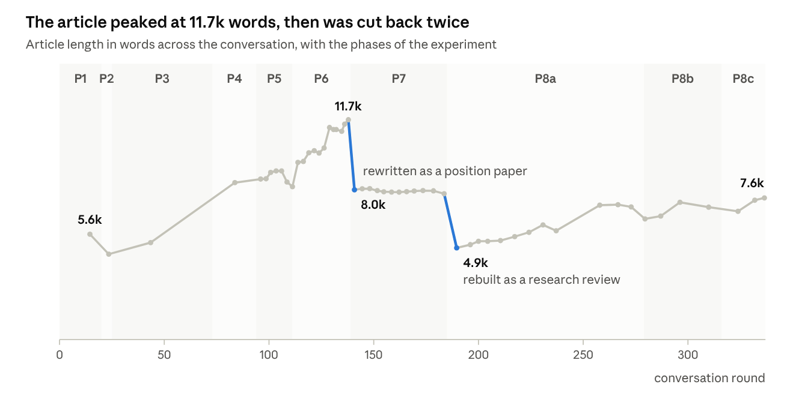

*Data: length_timeline.csv · 54 sampled revisions, mapped to conversation rounds*

- **P1, newcomer guide (rounds 1–20).** The initial request and the first pivot - focusing on 3 major alignment problems - hallucinations, omissions, and agent orchestration alignment (aka. incorrect agent actions).
- **P2, guide trimmed (21–25).** Shortening the document and adding the fourth problem type - misunderstandings.
- **P3, concept decomposition (26–73).** Refactoring the structure of the document to de-confound the main concepts
- **P4, naming (74–94).** Changing the names assigned to two of the four problems - incorrect agent actions and misunderstandings
- **P5, alignment framing (95–111).** Research and evidence that would explain misunderstanding alignment problem and clearly differentiate it from incorrect agent orchestration training was not collected and often confused. I imposed the framing I used in another post I worked on - <https://substack.com/@piotrtrochim/p-213109156>
- **P6, theory of mind (112–139).** The agent recovered research that suggested striking similarity to the framing used by Theory of Mind. In this phase, I am refactoring the document to align the terminology with that framing and find latest research.
- **P7, Concept distillation (140–185).** During the work the paper started discussing too many issues and became a confusing mixture of a tech report and a foundational research. The drift was stark and made the paper almost indistinguishable from <https://substack.com/@piotrtrochim/p-213109156>. I decided to cut the entire content related to Theory of Mind and re-focus efforts around writing a Tech Report.
- **P8, research review (186–337).** The document was divided into 4 key chapters, each focusing on on problem type (hallucinations, omissions, incorrect agent actions and misunderstanding). Each chapter followed the same template - key data showing performance trends, open problems, latest research that included the benchmarks used to track progress, and finally known and applied solutions. I handheld the agent while crafting the first chapter, and then asked to apply what it learned to autonomously craft the remaining 3 chapters (tl;dr - the process didn't continue fully autonomously).

## Experiment results

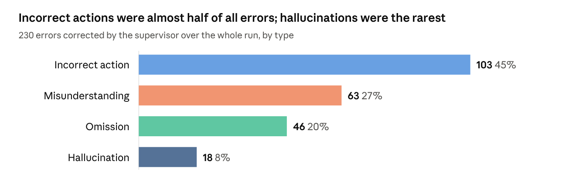

*Data: data_full.json · 230 errors classified from 337 rounds (self-audit)*

**Figure 1.** Distribution of errors by type

Across the whole run, I corrected 230 errors in 200 of the 337 rounds, an average of 6.8 errors per 10 rounds. Incorrect actions made up almost half of them. Hallucinations were the rarest type, with 18 in total, or fewer than one error in twelve.

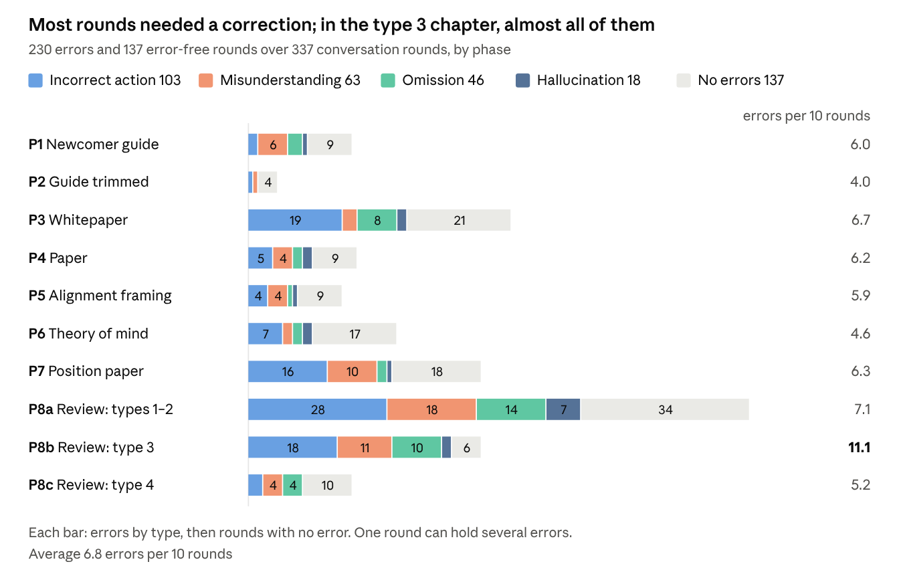

*Data: data_full.json · 230 errors classified from 337 rounds (self-audit)*

**Figure 2.** Distribution of errors per type and phase.

Two patterns stand out.

- **The error rate did not fall.** It stayed between about 5 and 7 errors per 10 rounds in most phases, then peaked at 11.1 in P8b. Later phases made stricter demands, such as peer-reviewed sources and figures covering the latest models, and the agent did not learn to meet them without reminders.
- **Errors repeated.** 102 of the 230 errors (44%) repeated a problem the supervisor had already corrected. Examples include figures that left out the latest models, walls of text, and preprints cited despite the rule to use peer-reviewed sources.

Errors also clustered in the parts of the article that made the most sourced claims: 40 in the chapters on types 1 and 2, 35 in the type 3 chapter and 21 in the figures.

### Time between errors

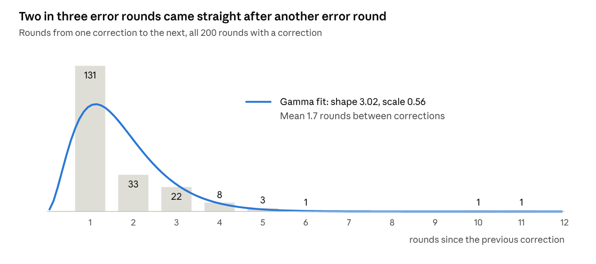

*Data: data_full.json · 200 gaps between corrections, gamma fit by maximum likelihood*

**Figure 3.** Rounds between corrections across the whole run.

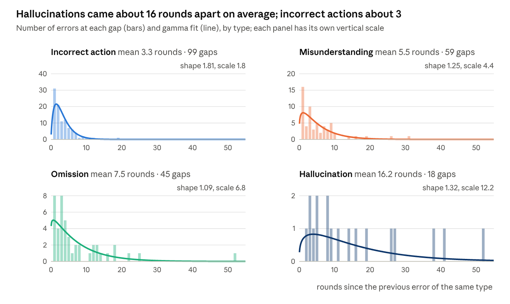

*Data: data_full.json · gaps between rounds containing each error type*

**Figure 4.** Rounds between errors of the same type.

Most of the results the agent returned contained errors. Figure 3 shows the number of rounds before I detected an error.

All error types follow that distribution, even the hallucinations which were the smallest group of errors we encountered. But what is very interesting are the outliers we can see there. Let's discuss those, but before we do, I need to put the errors in context of the work that I asked the agentic system to do.

### Errors by type of work

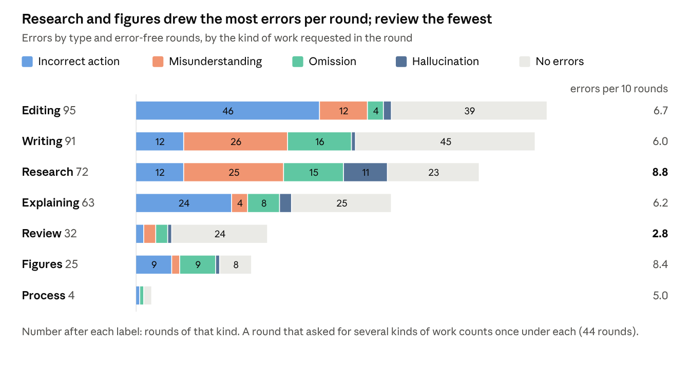

*Data: round_worktypes.json · 337 rounds tagged by the kind of work requested; errors from data_full.json*

**Figure 5.** Errors and error-free rounds by the kind of work asked for in the round where each error was corrected.

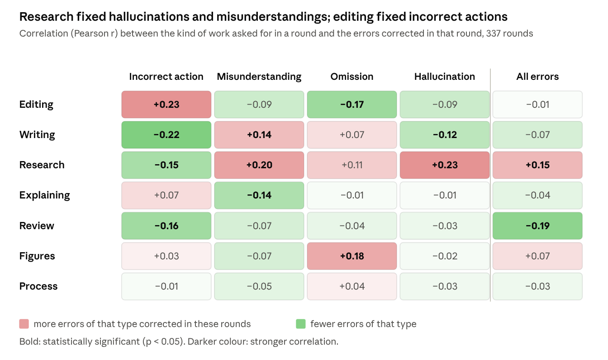

*Data: round_worktypes.json + data_full.json · Pearson r over 337 rounds, work tag (0/1) vs. error count*

**Figure 6.** Correlation between the kind of work asked for in a correction and the errors it corrected.

I divided the requests I made into 7 distinct groups - from Editing to working on plots (Figures), with the 7th group - Process - being related to instructing the agent how to perform specific requests.

The most interesting finding are the correlations between the error types and the work I asked for in the round where I corrected them. That is the work each correction called for: matched instead with the request that produced the error, none of these correlations holds (all \|r\| ≤ 0.08).

Some are not surprising - correcting Hallucinations called for Research, which is the act of finding information online - the model simply returned made up stuff.

The surprising finds were that most Omissions were corrected while working on Figures - so reformatting the findings in order to show the facts in a different way. I expected this is where most Misunderstandings would take place.

The other surprising finding was the amount of Incorrect actions corrected during editing - I would expect this would be the category where Omissions would happen most. The agent would collect information, and then omit to add it to the text.

## Patterns of error occurrence

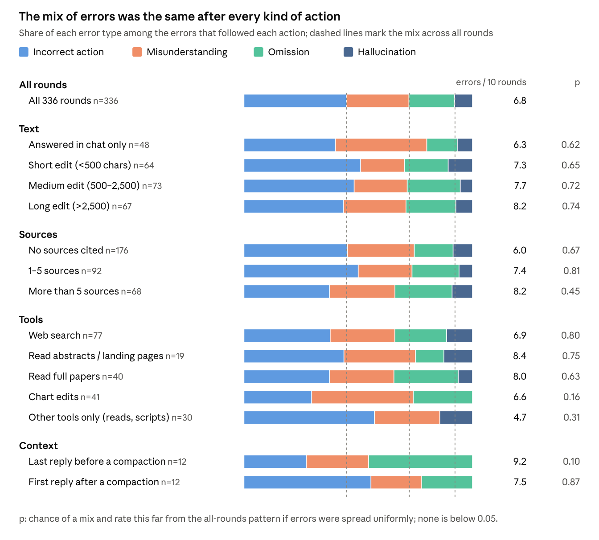

*Data: feat_*.jsonl (actions measured from the transcript) + data_full.json · 336 rounds; chi-square goodness of fit against the all-rounds error rates*

**Figure 7.** The mix of errors after each kind of agent action, against the mix across all rounds. The last of the 337 rounds has no reply after it, so 336 are counted.

I was interested in specific work that the agent does leads to specific types of errors more frequently than the other.

This time around I was interested in correlating the errors with what the agent does and the type of data it deals with - types of tool calls it performs, length of the text it wrote, number of external sources it pulled and how deeply it read them.

The data revealed no statistically significant effect of what the agent did on the mix or the rate of errors (Figure 7), with one possible exception: how full the agent's context was, which seemed to affect omissions.

In the last reply before each of the 12 likely context compactions, when the context was at its fullest, an omission followed 5 times out of 12, against 13% of rounds overall (p = 0.02 for omissions alone; Figure 7 tests the mix of all four types, where the difference is not significant, p = 0.10). The first reply after a compaction was back to normal. With only 12 compactions this is a strong hint rather than proof, but it matches another extreme: responses with more than about 16 tool calls, which also fill the context quickly, were followed by an omission 41% of the time (11% otherwise; any cut-off between 10 and 20 tool calls gives a significant difference). The fuller the context, the more the agent left out.

### Outlier study: 31 rounds without a misunderstanding (rounds 47–78)

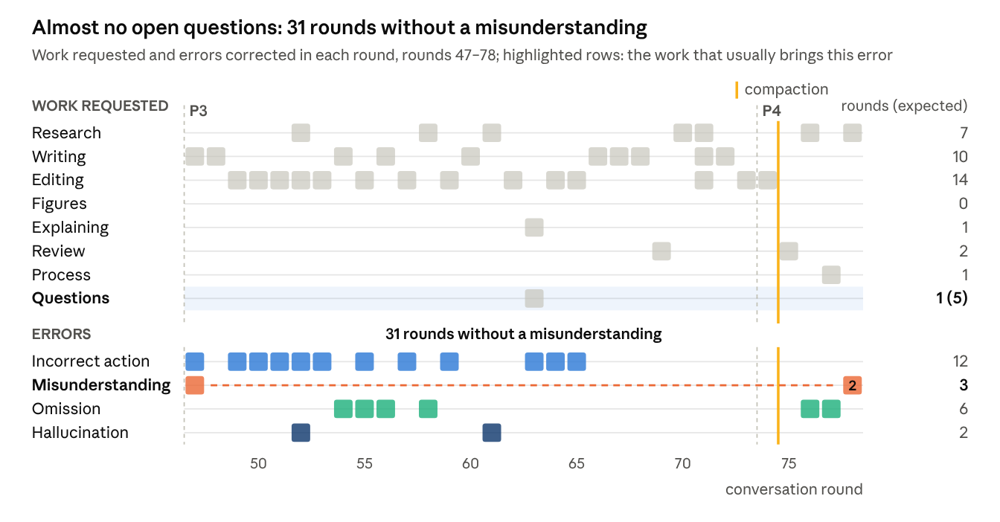

*Data: round_worktypes.json + data_full.json · rounds 47–78*

**Figure 8.** Work requested and errors corrected in rounds 47–78.

In this stretch I asked almost no open questions (only 1, where about 5 would be expected), and most of the work was editing text I had already laid out. The gap opened in round 47, when I asked the agent to explain *why* models skip the steps a task implies and it patched the text instead. It closed when my requests became interpretive again: in round 76 I asked what the research says, in round 77 I asked the agent to count how often I had redirected it, and in round 78 it read that as a request to promise better work. Two omissions came on the way (rounds 76 and 77), in the first two replies after the compaction just before round 75, although across the run replies just after a compaction were no more prone to omissions than the rest (Figure 12).

### Outlier study: 52 rounds without an omission (rounds 145–197)

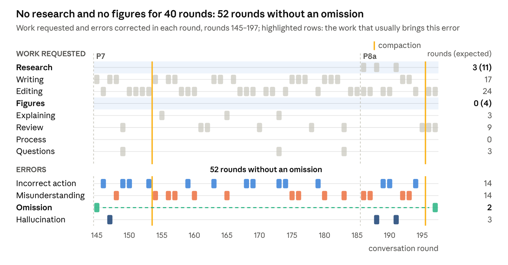

*Data: round_worktypes.json + data_full.json · rounds 145–197*

**Figure 9.** Work requested and errors corrected in rounds 145–197.

Here I was defining my own concepts: intent as an imagined end state plus constraints, type 3 as the wrong trajectory and type 4 as the wrong goal. Research came up in 3 of 53 rounds (about 11 expected), all after round 186, and there were no figures, so there was little outside material to leave out. Misunderstandings filled the gap instead (14 of them), as the agent kept mapping my definitions onto familiar ones. Research returned in round 186, when I turned the paper into a tech report, and the omission followed in round 197: the agent ran one review pass and stopped with issues still open.

### Outlier study: 26 rounds without a misunderstanding (rounds 110–136)

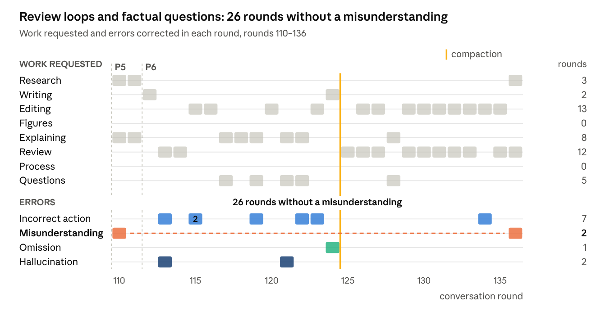

*Data: round_worktypes.json + data_full.json · rounds 110–136*

**Figure 10.** Work requested and errors corrected in rounds 110–136.

Most of this stretch was a review loop: the agent reviewed the paper, listed issues and fixed them, and I approved each pass with "go". My questions were factual (whether CLIPS is an image model, why a sentence had been deleted), so there was little to interpret. The gap closed in round 136, when I pointed out that the fixes were only stylistic and asked for substance: novelty, grounding and benchmark results.

### Outlier study: 19 rounds without an incorrect action (rounds 65–84)

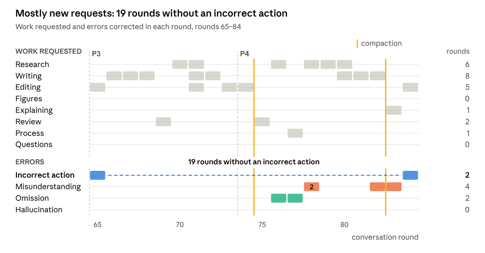

*Data: round_worktypes.json + data_full.json · rounds 65–84*

**Figure 11.** Work requested and errors corrected in rounds 65–84.

Incorrect actions came most often while the agent was fixing an earlier correction. Inside this gap 12 of 18 rounds were new requests (about 5 expected): my own framing of intent understanding, a review, research and new sections, rather than fix-ups. Errors kept coming, but they were omissions and misunderstandings. The gap closed in round 84, the first plain editing correction after the streak of new work.

## Discussion

The work, from start to finish, took about **20 hours of my work**. I am specifically not focusing on the amount of work performed by the Claude Cowork, because my entire purpose is to show how these tools really help human work.

So by any means, completing this work was not as easy as sending a prompt and publishing the results.

What would have happened if I published those results - you would read a dry summary of research from 1990-2020.

Four findings stand out.

**Errors were frequent, and few of them were hallucinations.** I had to correct the agent in 200 of 337 rounds. Incorrect actions (type 3) were the largest group, 103 of 230 errors (45%). Misunderstandings (type 4) came second with 63 (27%), and omissions (type 2) third with 46 (20%). Hallucinations, the error most discussions of LLM reliability focus on, made up only 18 (8%).

**Each kind of error needed its own kind of correction** (Figure 6). Matched with the request that produced it, no kind of error was tied to a kind of request:

- hallucinations were corrected with research, by finding real sources;
- omissions were corrected in figures and research, the work that brings outside material in;
- incorrect actions were corrected with editing, most often while the agent was fixing an earlier correction;
- misunderstandings were corrected with research and writing that spelled out my intent: new definitions and open questions.

**Omissions spiked when the context was full.** The reply written just before a context compaction, when the context was at its fullest, was followed by an omission 5 times out of 12 (42%, against 13% of rounds overall). After a compaction the rate went straight back to normal (Figure 12). Replies with more than about 16 tool calls, which also fill the context quickly, point the same way: they were followed by an omission 41% of the time.

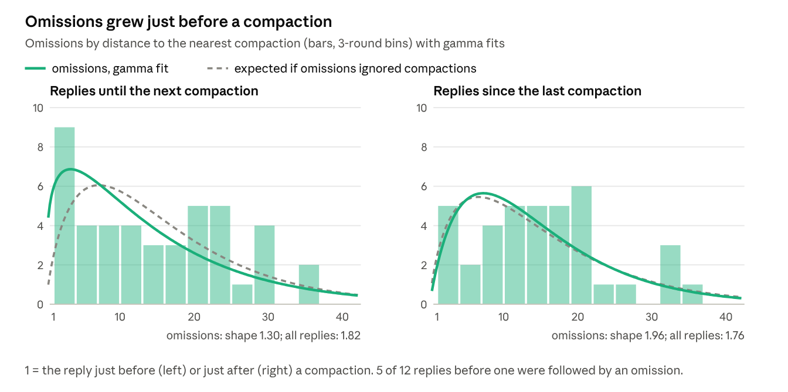

*Data: data_full.json + 12 likely compactions · omissions by replies to the next / since the last compaction, gamma fits by maximum likelihood*

**Figure 12.** Omissions by distance to the nearest context compaction. Before a compaction (left) they bunch up in the last few replies; after it (right) they follow the same distribution as all replies.

**Apart from the correlation between omissions and how full the context was, errors did not depend on what the agent did** (Figure 7). The length of the text it wrote, the number of sources it cited, how deeply it read them and which tools it used left the mix and the rate of errors unchanged.
